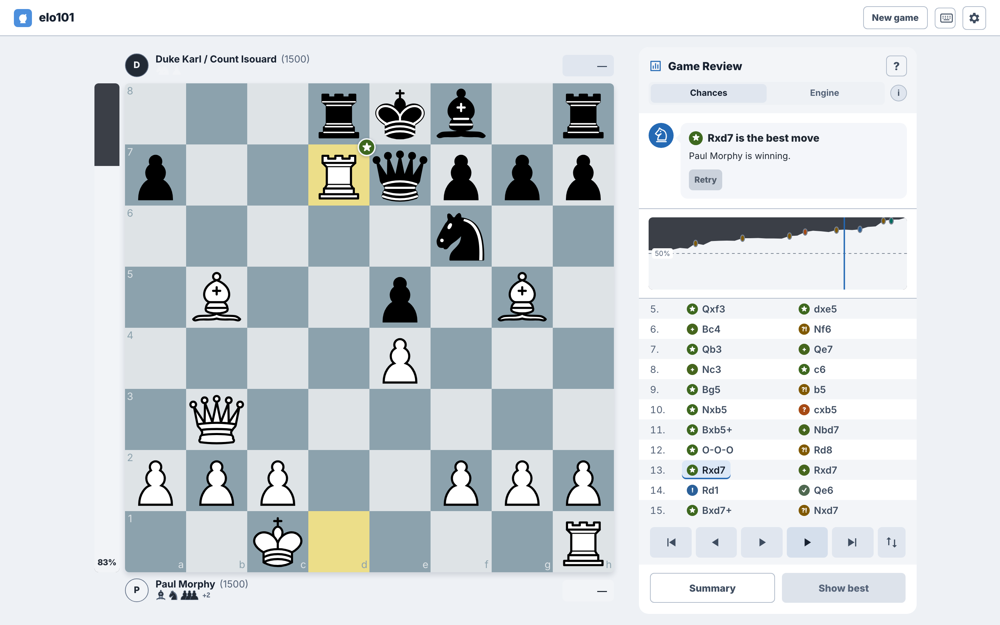
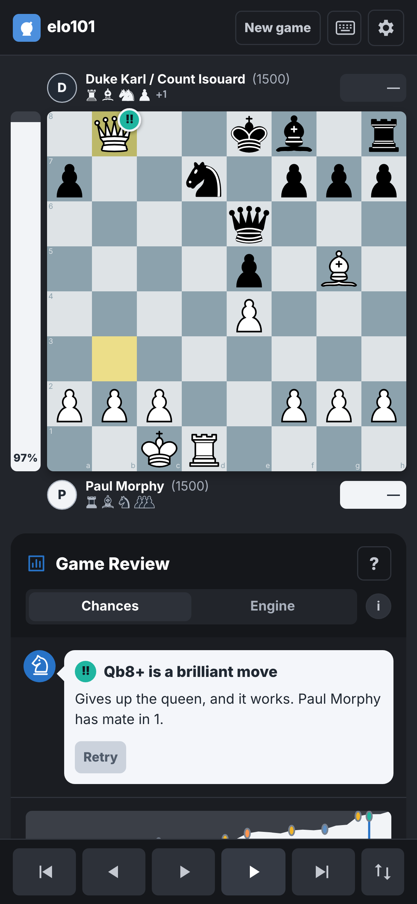
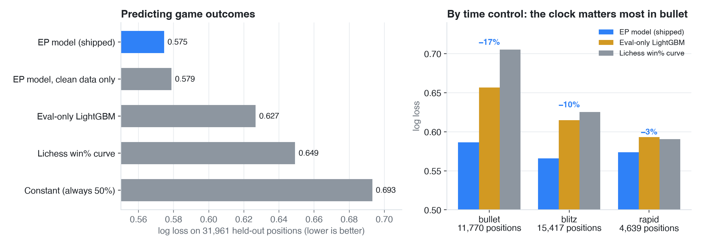
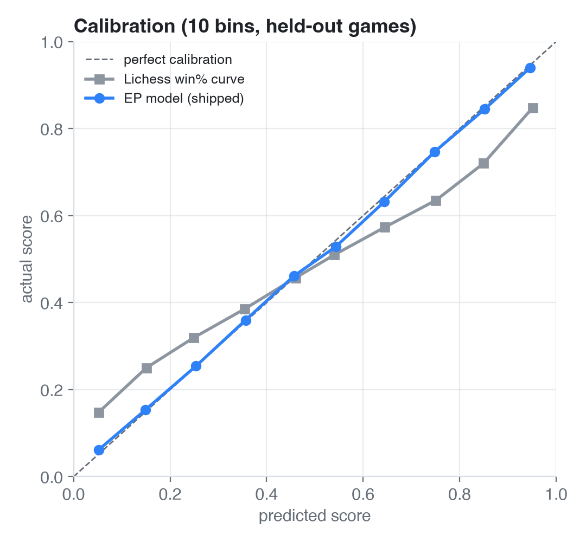
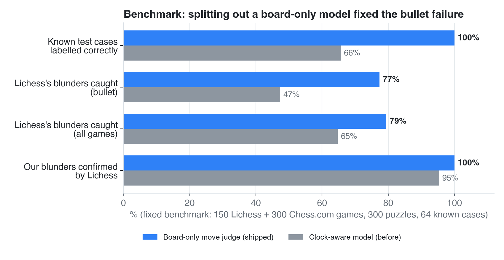
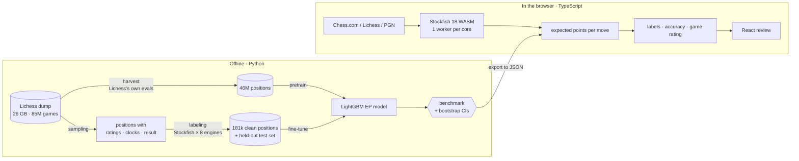

<div align="center">

# ♞ elo101

**Free chess game review that judges every move by your real chances, at your rating, on your clock.**

[](https://github.com/NazmulHayat/ChessCoach/actions/workflows/ci.yml)
[](LICENSE)


### [**▶ Try it: elo101.vercel.app**](https://elo101.vercel.app/)

No account, nothing uploaded. Stockfish, the models and the review all run in your browser.


</div>

## Why

Stockfish says **+1.5** whoever is playing. But +1.5 for two 800s with 10 seconds left is not +1.5 for two 2200s in a rapid game.

elo101 learns **expected points**: how often a player at *this rating*, in *this time control*, with *this much time left*, actually scores from a position. It is trained on millions of Lichess games. Every move is labelled by how much it changed those chances, Chess.com-style (Best → Blunder, plus Great, Miss and Brilliant).

## Highlights

| | |
|---|---|
| 📉 **11.5% lower log loss** than Lichess's win% curve | 31,961 held-out positions from unseen games; **−17% in bullet** |
| ⚡ **46M training positions in 15 minutes** | harvested from 85M games (26 GB) instead of ~60 days of engine time |
| 🎯 **100% of our blunders confirmed by Lichess** | fixed benchmark of 450 games, 300 puzzles and 64 known cases |
| 🧠 **LightGBM vs PyTorch** | an MLP matches the shipped model but doesn't beat it, so the smaller model ships |
| 🌐 **Runs 100% in the browser** | Stockfish WASM on every core, LightGBM trees evaluated in TypeScript |
| 🔁 **Python ↔ TypeScript parity** | 58 full game reviews must match the Python reference exactly |

## Screenshots

<table>
  <tr>
    <td width="50%"></td>
    <td width="50%"></td>
  </tr>
  <tr>
    <td align="center"><b>Review</b>: Morphy's 16. Qb8+!! (1858)</td>
    <td align="center"><b>Summary</b>: accuracy and game rating</td>
  </tr>
  <tr>
    <td></td>
    <td></td>
  </tr>
  <tr>
    <td align="center"><b>Retry</b> your mistakes on the board</td>
    <td align="center"><b>Light theme</b>, board colours, sounds</td>
  </tr>
</table>

<p align="center">
  
  &nbsp;&nbsp;
  
</p>

## Results

<picture>
  <source media="(prefers-color-scheme: dark)" srcset="docs/images/results-dark.png">
  
</picture>

| Model | Training data | Log loss |
|---|---|---|
| **EP model (shipped)**: pretrain + fine-tune | 12M harvested → 154k Stockfish positions | **0.575** |
| PyTorch MLP (best of 3 seeds) | 181k Stockfish positions | 0.575 |
| EP model, Stockfish data only | 181k Stockfish positions | 0.579 |
| Eval-only LightGBM (no rating / clock) | 181k | 0.627 |
| Lichess win% curve | none | 0.649 |

<table>
<tr>
<td width="42%">
<picture>
  <source media="(prefers-color-scheme: dark)" srcset="docs/images/calibration-dark.png">
  
</picture>
</td>
<td>

- **Calibrated**: every 10-point bin is within 1.5 points of the truth.
- **Pretrain + fine-tune** beats clean data alone: −0.0043, 95% CI −0.0065 to −0.0021 (paired bootstrap over games).
- **More data stopped helping**: 25M rows gave no significant gain over 12M.
- **The neural net ties**: an MLP matches the shipped model without any harvested data, but doesn't beat it.

</td>
</tr>
</table>

<picture>
  <source media="(prefers-color-scheme: dark)" srcset="docs/images/benchmark-dark.png">
  
</picture>

A user's bullet game showed 0 blunders where Lichess found 2: the clock-aware model was right that bullet is decided by the clock, which made it wrong for judging moves. Moves are now judged by a separate board-only model, chosen on a [fixed benchmark](docs/benchmark.md).

**Game rating follows accuracy.** The more accurate player never gets the lower game rating (0 exceptions in 40,000 held-out games), and the higher game rating wins 95.6% of decisive games. **Brilliant is rare**: it needs a real sacrifice the opponent accepts, about 1 in 40 games. [How both work →](docs/methodology.md#game-rating-performance-in-this-game)

## How it works



<details>
<summary><b>Engineering notes</b></summary>

- **Not computing at all was the biggest speedup.** About 11% of Lichess games already carry server evals; a streaming parser extracted 46M labelled positions in 15 minutes.
- **A counterfactual move loss.** The played move and the best move are scored on identical rows, so the model's side-to-move bias cancels.
- **Matching Lichess's accuracy** exposed an undocumented detail: each move is floored at 1 in the harmonic mean.
- **Moving the server into the browser** surfaced a threefold-repetition rule python-chess applies and chess.js doesn't. It also needed a 50× faster static exchange.
- **Deterministic reviews**: Stockfish's hash carried over between positions; clearing it took repeatability from 78% to 100%.

All 28 problems, with before/after numbers: [engineering log](docs/engineering-log.md#problems-solved).

</details>

## Tech stack

| Area | Tools |
|---|---|
| ML & data | Python, LightGBM, PyTorch, pandas, Parquet, zstandard, multiprocessing |
| Chess | Stockfish 18 (native + WebAssembly), python-chess, chess.js |
| App | React 19, TypeScript, Vite, Web Workers, Vercel |
| Quality | pytest, Vitest (with Python parity), ESLint, GitHub Actions |

## Run it

```bash
cd web && npm install && npm run dev        # app at http://localhost:5173
```

```bash
python -m venv .venv && source .venv/bin/activate
pip install -r requirements.txt             # Python side; needs Stockfish on PATH
make test                                   # pytest
make benchmark                              # score the shipped model
make help                                   # everything else
```

Training the model from a Lichess dump: [`docs/training-pipeline.md`](docs/training-pipeline.md). Optional FastAPI server with Docker: see the [`Dockerfile`](Dockerfile).

## Project structure

```
ep_model/           Python: data pipeline, models, reference review
  sampling/         stream the Lichess dump, sample positions
  labeling/         Stockfish evals with a parallel engine pool
  harvest/          extract Lichess's own evals from the dump
  training/         LightGBM, PyTorch MLP, evaluation with bootstrap CIs
  review/           move labels, accuracy, game rating, optional server
  benchmark/        frozen benchmark sets and scorer
web/                React + TypeScript app (fully client-side)
  src/review/       TypeScript port of the review + parity tests
  src/engine/       Stockfish WASM worker pool
tests/              pytest suite
docs/               methodology, benchmark, engineering log
```

## Docs

[Methodology](docs/methodology.md) · [Benchmark](docs/benchmark.md) · [Engineering log](docs/engineering-log.md) · [Training pipeline](docs/training-pipeline.md)

## License

[MIT](LICENSE). Data: [Lichess open database](https://database.lichess.org/) (CC0). Engine: [Stockfish](https://stockfishchess.org/) (GPLv3, run as a separate program). Not affiliated with Chess.com or Lichess.
