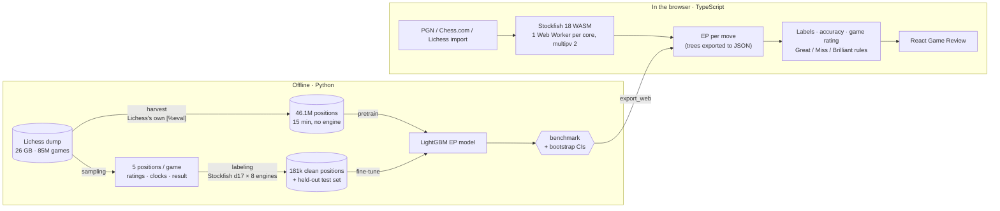

<div align="center">

# ♞ ChessCoach

**Chess game review that judges every move by your real chances, at your rating, on your clock.**

[](https://github.com/NazmulHayat/ChessCoach/actions/workflows/ci.yml)
[](https://github.com/NazmulHayat/ChessCoach/actions/workflows/pages.yml)
[](LICENSE)


### [**Try it live → nazmulhayat.github.io/ChessCoach**](https://nazmulhayat.github.io/ChessCoach/)

Free, no account, nothing uploaded: Stockfish, the models and the review all run in your browser.


</div>

---

## The idea

Stockfish says **+1.5** no matter who is playing. But a +1.5 position means something very different for two 800s with 10 seconds left than for two 2200s in a rapid game.

ChessCoach asks a different question: ***how often does a player at this rating, in this time control, with this much time left, actually score from here?*** That number is the **expected points (EP)**. It is learned from millions of real Lichess games and drives a Chess.com-style Game Review. Each move is labelled by how much it changed the mover's practical chances, not by a fixed centipawn cutoff.

Chess.com's Game Review also uses an expected-points model ([their docs](https://support.chess.com/en/articles/8572705-how-are-moves-classified-what-is-a-blunder-or-brilliant-move)). ChessCoach is an **open, measurable rebuild of that idea**. It is trained on the public Lichess database, extended with time pressure, and checked against simpler baselines and the sites' own verdicts.

## Highlights

| | |
|---|---|
| 📉 **11.5% lower log loss** than Lichess's win% curve | 31,961 held-out positions from 6,403 unseen games; **−17% in bullet** |
| ⚡ **46.1M training positions in 15 minutes** | Harvested from 84.6M games (26 GB) already analysed by Lichess's servers, instead of ~60 days of engine time |
| 🎯 **100% of our blunders confirmed by Lichess** | Fixed benchmark: 150 Lichess + 300 Chess.com games, 300 puzzles, 64 known cases |
| 🧩 **99.3% of puzzle solutions** rated Best / Great / Brilliant | 300 Lichess puzzles |
| 🌐 **Runs 100% client-side** | Stockfish 18 WebAssembly on one Web Worker per core; LightGBM trees evaluated in TypeScript; static hosting on GitHub Pages |
| 🔁 **Bit-for-bit parity with Python** | 85 Vitest tests, including 58 full game reviews that must match the Python reference in every label and number |
| 📊 **Every model change gets a 95% CI** | Paired bootstrap over whole games; ship only on a significant gain |

## Screenshots

<table>
  <tr>
    <td width="50%"></td>
    <td width="50%"></td>
  </tr>
  <tr>
    <td align="center"><b>Review</b>: 16. Qb8+ in Morphy's Opera Game (1858) is labelled <i>Brilliant</i>, and the coach explains why</td>
    <td align="center"><b>Summary</b>: accuracy (Lichess's formula), "played like" game rating, label counts</td>
  </tr>
  <tr>
    <td></td>
    <td></td>
  </tr>
  <tr>
    <td align="center"><b>Retry</b>: replay your mistake on the board, judged by the same model</td>
    <td align="center"><b>Light theme</b>: System / Light / Dark, four board colours</td>
  </tr>
</table>

<p align="center">
  
  &nbsp;&nbsp;
  
</p>

## Results

### Predicting outcomes

<picture>
  <source media="(prefers-color-scheme: dark)" srcset="docs/images/results-dark.png">
  
</picture>

Held-out test set: **31,961 positions from 6,403 games** that no model saw, labelled with our own Stockfish at depth 17 and split by game. Lower is better.

| Model | Training data | Log loss | Brier |
|---|---|---|---|
| **EP model (shipped)**: pretrain + fine-tune | 12M harvested positions → 154k Stockfish positions | **0.575** | **0.189** |
| EP model, Stockfish data only | 181k Stockfish positions | 0.579 | 0.190 |
| EP model, harvested data only | 12M harvested positions | 0.581 | 0.192 |
| PyTorch MLP (best of 3 seeds) | 181k Stockfish positions | 0.575 | 0.189 |
| Eval-only LightGBM (no rating / clock context) | 181k | 0.627 | 0.210 |
| Lichess win% formula | none | 0.649 | 0.215 |
| Constant (always 50%) | none | 0.693 | 0.240 |

<table>
<tr>
<td width="42%">
<picture>
  <source media="(prefers-color-scheme: dark)" srcset="docs/images/calibration-dark.png">
  
</picture>
</td>
<td>

- **Context is worth 8.3%.** The same LightGBM without rating, clock and time control scores 0.627. Context matters most where time pressure does: **0.586 vs 0.705 in bullet (−17%)**.
- **Pretrain + fine-tune is significantly better** than clean data alone: −0.0043 log loss, 95% CI −0.0065 to −0.0021 (paired bootstrap over games).
- **Calibrated.** In every 10-point bin, the actual score is within 1.5 points of the prediction. The Lichess curve is off by up to 10.
- **More data stopped helping.** Doubling pretraining to 25M rows gave −0.0002 (CI −0.0011 to +0.0007), so the smaller model shipped.
- **The neural net ties.** An MLP matches the shipped model without any harvested data, but doesn't beat it, so LightGBM stays (it also exports cleanly to the browser).

</td>
</tr>
</table>

### Are the labels right?

<picture>
  <source media="(prefers-color-scheme: dark)" srcset="docs/images/benchmark-dark.png">
  
</picture>

A user's 1+0 bullet game showed **0 blunders and 94% accuracy, while Lichess found 2 blunders and 81%**. The clock-aware model had learned, correctly, that bullet games are decided by the clock, so giving away a queen barely moved the "chances". The fix was to keep that model for the chances bar and to **judge moves with a separate board-only model**, chosen on a [fixed benchmark](docs/benchmark.md) that scores every change per time class:

- **Lichess's own verdicts** (100 analysed games, 6,016 moves): 94.6% of our blunders are also Lichess errors; only 1.1% false alarms.
- **Lichess puzzles** (300): the winning move is rated Best / Great / Brilliant 99.3% of the time; the blunder that starts the puzzle is flagged 100% of the time when the player wasn't already lost.
- **Accuracy** matches what Lichess displays to within **0.32 points** on average (762 player scores).
- **Repeatable**: re-reviewing a game gives identical labels (78.2% → 100% after clearing engine state between positions, at +5% time).

## How it works



1. **Sampling** streams the compressed dump and keeps about five positions per game, with both ratings, both clocks, time control and the result.
2. **Labeling** runs Stockfish at depth 17 on a pool of single-threaded engines, with a FEN cache and resumable checkpoints. This clean set provides fine-tuning data and the held-out test set.
3. **Harvest** reads the engine evals Lichess's servers already wrote into about 11% of games. A multi-process streaming parser gets 46.1M positions in 14.8 minutes (~95k games/s).
4. **Training** pretrains LightGBM on the harvested set and fine-tunes it on clean data. That fixes a distribution shift between the two sources. Every comparison reports a paired bootstrap CI over games.
5. **Review** compares the EP of the move played with the EP of the engine's best move, both scored on the same opponent-to-move row so the model's side-to-move bias cancels. The loss maps to Chess.com's published bands (best, excellent < 2%, good < 5%, inaccuracy < 10%, mistake < 20%, blunder ≥ 20%). Great / Miss / Brilliant follow [documented rules](docs/methodology.md#great-miss-and-brilliant) on the engine's top two lines, with a static-exchange check for sacrifices.
6. **Browser port**: the three models are exported to JSON (9.6 MB) and evaluated by a small TypeScript tree walker that reproduces LightGBM's split and missing-value rules. The review logic is ported module by module and held to the Python reference by parity tests. A 61-move bullet game reviews in about 14 s on a laptop.

## Engineering highlights

A few of the [26 problems solved](docs/engineering-log.md#problems-solved), each with before/after numbers:

- **The biggest speedup was not computing at all.** Labelling 46M positions with the engine pool would have taken ~60 days. Harvesting Lichess's existing analysis took 15 minutes, and the engine-labelled games stay out of it so the test set stays clean.
- **A counterfactual move loss.** Comparing EP before and after a move mixes two side-to-move contexts and creates fake losses. Scoring the played move and the best move on identical rows makes the bias cancel.
- **A model that was right for the wrong job.** The clock-aware model correctly predicted outcomes, but it was wrong for judging moves. Splitting it in two took known-case accuracy from 65.6% to 100%.
- **Accuracy that matched Lichess exposed an undocumented detail.** Lichess floors each move at 1 in the harmonic mean; without that, one game was off by 15 points.
- **Moving the server into the browser.** Free hosting meant no server. The port surfaced a threefold-repetition rule python-chess applies and chess.js doesn't (2 of ~3,000 moves). It also needed a 50× faster static exchange, built on chess.js's internal move generator (5 min → 6 s).
- **Flaky to deterministic.** Stockfish's hash carried over between positions, so 21.8% of labels changed on a re-review. Clearing it per position fixed that at 5% cost.

## Tech stack

| Area | Tools |
|---|---|
| Data & training | Python 3.11+, pandas, PyArrow / Parquet, zstandard (streaming), LightGBM, PyTorch (comparison model), multiprocessing |
| Chess | Stockfish 18 (native for training, WebAssembly in the app), python-chess, chess.js, polyglot opening book |
| App | React 19, TypeScript, Vite, Web Workers, react-chessboard, Web Audio (synthesised sounds) |
| Optional server | FastAPI with server-sent events, Docker (Stockfish compiled from source), Fly.io / Render configs |
| Quality | pytest (62), Vitest (85, incl. Python parity), ESLint, GitHub Actions CI, fixed benchmark |

## Getting started

**Use it:** [nazmulhayat.github.io/ChessCoach](https://nazmulhayat.github.io/ChessCoach/). Import a Chess.com or Lichess username, paste a PGN, or try the sample game.

**Run the app locally** (Node 18+):

```bash
cd web
npm install
npm run dev          # http://localhost:5173
```

**Python side** (training, benchmark, the reference review and the optional server) needs Python 3.11+ and [Stockfish](https://stockfishchess.org/) on your `PATH`:

```bash
python -m venv .venv && source .venv/bin/activate
pip install -r requirements.txt

make test                                                # pytest
make benchmark                                           # score the shipped model on the fixed benchmark
python -m ep_model.review.review game.pgn --html out.html  # command-line review
python -m ep_model.review.server                         # optional server version → http://127.0.0.1:8000
```

`make help` lists all targets. `make check` runs everything CI runs.

<details>
<summary><b>Train your own model</b></summary>

```bash
# Put a Lichess monthly dump (database.lichess.org) at ep_model/raw/*.pgn.zst
python -m ep_model.sampling.generate_rows --max-games 100000 --resume
python -m ep_model.scripts.safe_run --policy ep_model/config/engine_policy_parallel.json --workers 8
python -m ep_model.harvest.lichess_evals          # Lichess server evals → ep_model/processed_lichess/
python -m ep_model.training.train -v              # clean model + held-out test split
python -m ep_model.training.train --processed-dir ep_model/processed_lichess \
    --pattern "rows_lichess_part*.parquet" --max-rows 12000000 --num-leaves 127 \
    --output-dir ep_model/models_lichess          # pretrain on harvested data
python -m ep_model.training.finetune              # → ep_model/models_finetuned
python -m ep_model.training.evaluate \
    --extra-model ep_lichess=ep_model/models_lichess \
    --extra-model ep_finetuned=ep_model/models_finetuned   # → ep_model/models/ep_eval_report.md
python -m ep_model.scripts.export_web             # models + parity fixtures for the browser
python -m ep_model.scripts.make_figures           # README charts
```

Or run all of it with `ep_model/scripts/run_big_training.sh`. Pipeline details are in [`docs/training-pipeline.md`](docs/training-pipeline.md) and [`ep_model/README.md`](ep_model/README.md).

</details>

<details>
<summary><b>Docker / server deployment</b></summary>

The static site needs no server. The original FastAPI version is still available, and adds Claude-written move explanations when `ANTHROPIC_API_KEY` is set:

```bash
docker build -t chesscoach .
docker run -p 8000:8000 chesscoach        # → http://127.0.0.1:8000
```

The image compiles Stockfish 18 for the target CPU and serves the built frontend. Settings: `CHESSCOACH_DEPTH` (17), `CHESSCOACH_WORKERS`, `CHESSCOACH_MAX_CONCURRENT`, `CHESSCOACH_REVIEWS_PER_HOUR`, `CHESSCOACH_MAX_PLIES`, `ANTHROPIC_API_KEY`. Deploy with [`fly.toml`](fly.toml) (`fly deploy`) or [`render.yaml`](render.yaml) (Render Blueprint).

</details>

## Project structure

```
ChessCoach/
├── ep_model/                 Python: data pipeline, models, reference review
│   ├── sampling/             stream the Lichess dump, sample positions and context
│   ├── labeling/             Stockfish evals: parallel engine pool, FEN cache, checkpoints
│   ├── harvest/              extract Lichess's own server evals straight from the dump
│   ├── training/             features, LightGBM train / fine-tune, PyTorch MLP, evaluation + bootstrap CIs
│   ├── review/               EPModel, move labels, Great/Miss/Brilliant, tactics, accuracy, game rating, FastAPI server
│   ├── benchmark/            frozen benchmark sets and the scorer
│   ├── scripts/              safe_run (long engine jobs), web export, figures
│   ├── config/               engine policies
│   └── models_board/, models_finetuned/   shipped models
├── web/                      React + TypeScript app (runs fully in the browser)
│   ├── src/review/           TypeScript port of the review + parity tests and fixtures
│   ├── src/engine/           Stockfish WASM worker pool and UCI parsing
│   ├── src/components/       board, coach, graph, move list, summary, import
│   └── public/               Stockfish 18 lite (WASM), models as JSON, opening book
├── tests/                    pytest suite
├── docs/                     methodology, benchmark results, engineering log, images
├── archive/                  the first rule-based classifier and finished experiments
└── .github/workflows/        CI (tests, lint, build) and GitHub Pages deploy
```

## Documentation

| Doc | What's in it |
|---|---|
| [`docs/methodology.md`](docs/methodology.md) | Data, features, training choices, label rules, validation design, caveats |
| [`docs/benchmark.md`](docs/benchmark.md) | Full benchmark tables per time class and model |
| [`docs/engineering-log.md`](docs/engineering-log.md) | Timeline, every key number, and 26 problems solved with before/after |
| [`docs/training-pipeline.md`](docs/training-pipeline.md) | How the dump becomes training rows, labels and a model |

## Limitations and next steps

- **Accuracy vs Chess.com differs by ~8 points.** Chess.com's accuracy formula is not published; ours follows Lichess's, which we match within 0.3.
- **We call 79% of Lichess's blunders a mistake or worse, against a 90% target** (85% in rapid, 77% in bullet and blitz). The gap is tracked on the benchmark and not yet closed.
- **The browser engine is Stockfish lite** (7 MB). The full 113 MB network exceeds GitHub Pages' file limit. Lite evals differ from native by a median of 16 centipawns.
- **Next:** more clean engine-labelled data and new features (pretraining volume has stopped helping), and pretraining the MLP on the harvested set.

## License and credits

[MIT](LICENSE) for this project's code. Game data: [Lichess open database](https://database.lichess.org/) (CC0). Engine: [Stockfish](https://stockfishchess.org/) (GPLv3, run as a separate program; see `web/public/engine/COPYING.txt`). Board: [react-chessboard](https://github.com/Clariity/react-chessboard) (MIT) and [chess.js](https://github.com/jhlywa/chess.js) (BSD). UI asset credits: [`web/public/CREDITS.md`](web/public/CREDITS.md). Not affiliated with Chess.com or Lichess.
