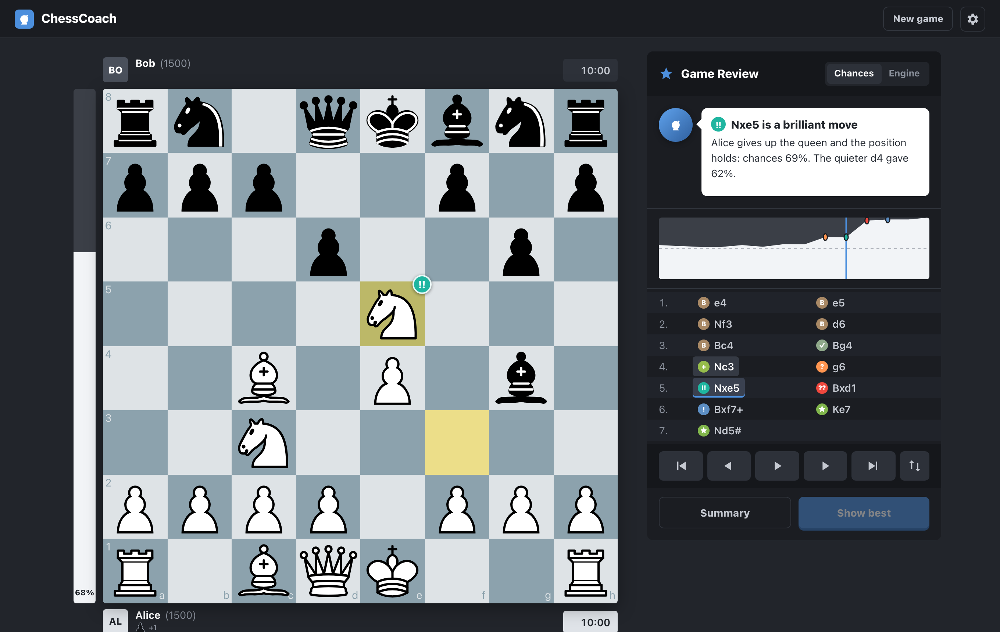
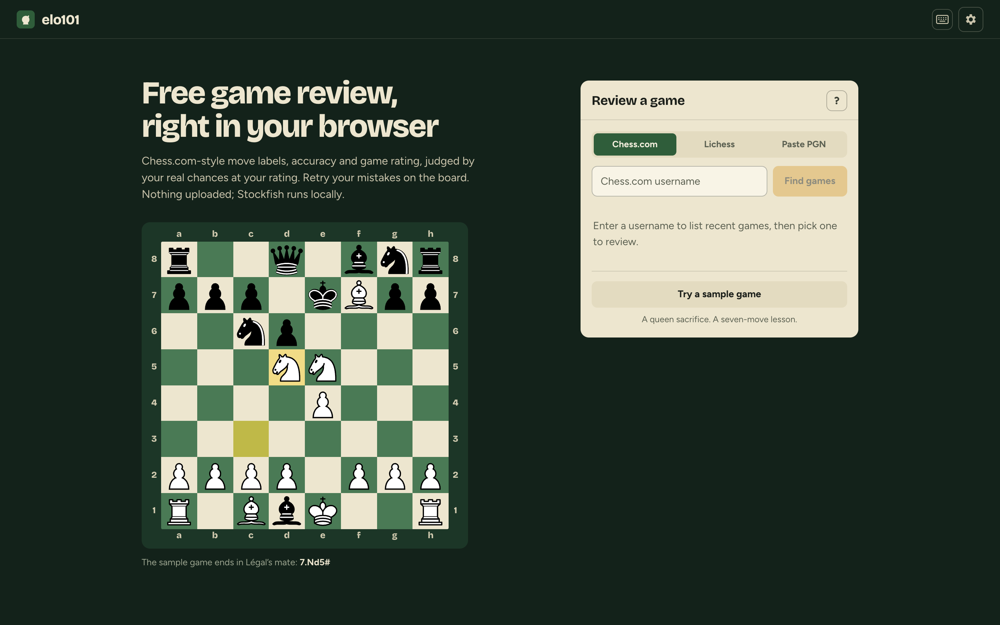
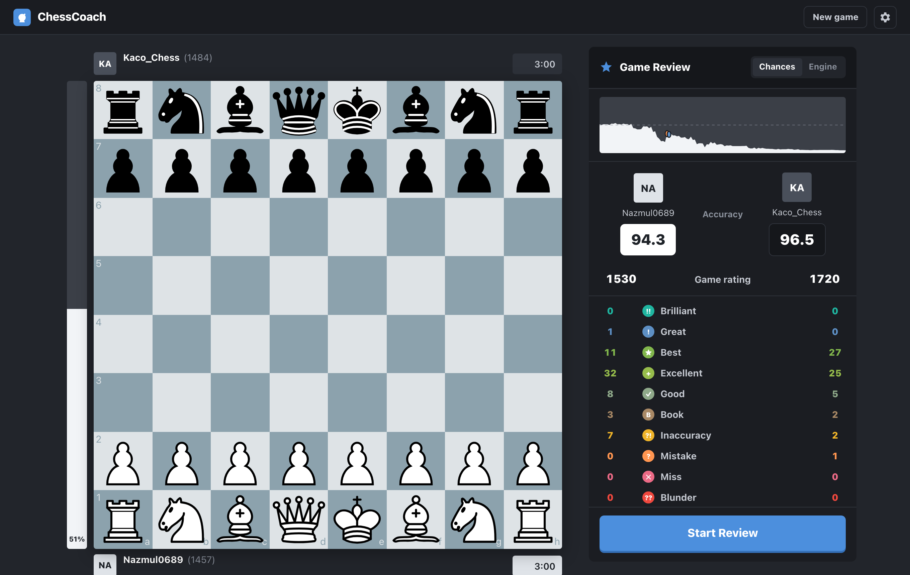
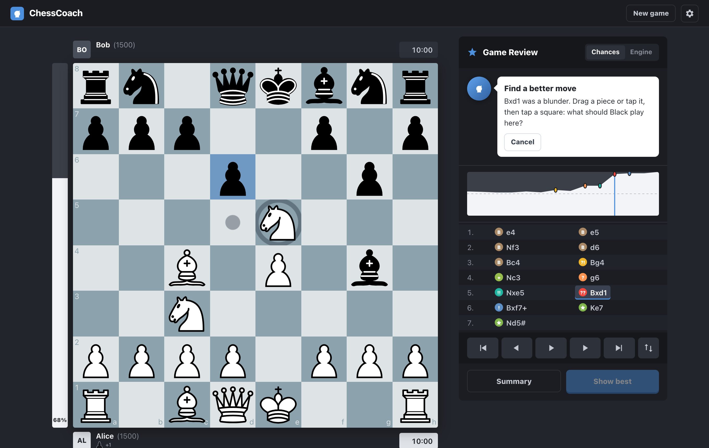

# ChessCoach

**Chess game review that judges moves by your real chances, at your rating, on your clock.**

**Try it: [nazmulhayat.github.io/ChessCoach](https://nazmulhayat.github.io/ChessCoach/)**. It runs entirely in your browser (Stockfish 18 as WebAssembly, the models and the review logic in TypeScript), so it's free, needs no account, and your games never leave your computer.

Stockfish says +1.5 no matter who is playing. ChessCoach asks a different question: *how often does a player at this rating, in this time control, with this much time left, actually score from here?* That number, **expected points (EP)**, drives a Chess.com-style Game Review: every move is labelled by how much it changed the mover's practical chances, not by a fixed centipawn cutoff.



*Screenshots show the earlier interface. The UI pass below adds a welcome screen, inline help, light mode, and phone controls; updated captures are pending.*

Chess.com's current Game Review also uses an expected-points model built from rating and engine eval ([their docs](https://support.chess.com/en/articles/8572705-how-are-moves-classified-what-is-a-blunder-or-brilliant-move)). ChessCoach is an **open, measurable rebuild of that idea, extended with time pressure**: it also conditions on time control and clock, is trained on the public Lichess database, and publishes how well it is calibrated against simpler baselines.

## Results

Held-out test: **31,961 positions from 6,403 games** that no model saw, labelled with our own Stockfish (depth 17). Split by game. Lower log loss is better.

| Model | Training data | Log loss | Brier |
|---|---|---|---|
| **EP model, fine-tuned** | 12M harvested Lichess positions, then 154k Stockfish positions | **0.575** | **0.189** |
| EP model, Stockfish data only | 181k Stockfish positions | 0.579 | 0.190 |
| EP model, harvested data only | 12M harvested Lichess positions | 0.581 | 0.192 |
| EP neural network (PyTorch MLP), best of 3 seeds | 181k Stockfish positions | 0.575 | 0.189 |
| Eval-only LightGBM (same model, no context) | 181k | 0.627 | 0.210 |
| Lichess win% formula | none | 0.649 | 0.215 |
| Constant | none | 0.693 | 0.240 |

- **11.5% lower log loss than the Lichess win% curve**, 8.3% lower than an eval-only model: the value of rating, clock and time-control context.
- **Bullet**: 0.586 vs 0.705 for the Lichess curve (−17%), where time pressure matters most.
- **Pretrain + fine-tune is significantly better** than training on the clean data alone: −0.0043 log loss, 95% CI −0.0065 to −0.0021 (paired bootstrap over games).
- **Calibrated**: in every 10-point bin, the actual score is within 1.5 points of the prediction.
- **PyTorch comparison**: an MLP on the same features and clean data beats LightGBM on that data in all 3 seeds (0.5745–0.5766 vs 0.5788; significant in 2) and ties the pretrained + fine-tuned model with no harvested data (no significant difference). Not shipped, since it doesn't beat the current model ([details](docs/methodology.md#data)).

**Are the labels right?** A fixed benchmark scores every change against targets, per time class ([results](docs/benchmark.md), [how](docs/methodology.md#benchmark)): 150 recent Lichess games with Lichess's verdicts, 300 Chess.com games with Chess.com's accuracy, 300 puzzles and 64 known cases. Moves are judged by a board-only model (no clock), after a user's bullet game showed the clock-aware model calling a queen giveaway "good": 100% of our blunders are also Lichess errors, our error counts match Lichess's within 2%, and all 64 known cases pass. Earlier checks, also against references we didn't produce ([details](docs/methodology.md#validation-against-independent-references)):

- **Lichess puzzles** (300): the winning move is labelled best / great / brilliant 99.3% of the time; the blunder that starts the puzzle is flagged 100% of the time when the player wasn't already lost.
- **Lichess's own verdicts** (100 analysed games, 6,016 moves): 94.6% of our blunders are also errors in Lichess's deeper analysis; only 1.1% of moves Lichess leaves unmarked get a mistake or blunder from us.
- **Accuracy** follows Lichess's published formula and matches the accuracy Lichess shows to within 0.32 points on average (762 player scores).
- **Repeatable**: reviewing a game twice gives identical labels (was 78% before clearing the engine between jobs).

Where the 12M positions came from: about 1 in 9 games in the Lichess dump was already analysed by Lichess's servers and carries an engine eval on every move. Harvesting those gave **46.1M labelled positions from 84.6M games in 15 minutes**, with no Stockfish time. Details in [`docs/methodology.md`](docs/methodology.md).

## The Game Review app

| Import | Summary | Retry |
|---|---|---|
|  |  |  |

- **Import** from a Chess.com or Lichess username (recent games, no login), paste a PGN, or try the bundled seven-move sample. The last five reviewed games stay in browser storage for re-analysis.
- **Live analysis**: Stockfish runs on a pool of parallel engines with the top two lines per position (a 62-move game at depth 17 in about 24 s with 4 engines; re-opening a game is instant from the cache); progress streams to the page.
- **Summary**: accuracy for both players (Lichess's method), a **game rating** ("played like a 1950": the rating of players who typically play as well as you did, next to your own), label counts, **opening / middlegame / endgame grades**, key moments, advantage graph.
- **Review**: board with move badges, last-move highlight, best-move arrows, move animation, captured pieces and material lead in the player bars; eval bar that switches between **Chances** (EP) and raw **Engine** score; a coach that explains each move and points out where an eval-only review would disagree; clickable graph; move list; flip button; keyboard (← → Home End, Space to play, F to flip).
- **Settings**: System / Light / Dark appearance, four board colors, and synthesized move sounds with volume, saved per browser. Phone controls stay visible; swipe the board to step through moves, or drag/tap pieces in retry mode. Motion follows your reduced-motion preference.
- **Help**: tap metric info buttons or the move-label legend, press `?` for keyboard shortcuts, and follow the dismissible first-review tour. Graph tooltips show the move, label and chances; the summary can hide unused labels.
- **UI assets**: Inter via Google Fonts (OFL 1.1), with a system-font fallback; built-in pieces and original synthesized audio. See [asset credits and fallback decisions](web/public/CREDITS.md).
- **Labels** use Chess.com's published expected-points bands: best (engine move), excellent < 2%, good < 5%, inaccuracy < 10%, mistake < 20%, blunder ≥ 20%, plus book moves from a polyglot opening book.
- **Great / Miss / Brilliant**: our own documented rules on the engine's top two lines. Great = the only good move; Miss = gives back most of the opponent's mistake; Brilliant = a sound sacrifice (static-exchange check) that wasn't needed to stay winning. Thresholds scale with rating. Rules in [`docs/methodology.md`](docs/methodology.md#great-miss-and-brilliant).
- **Coach**: template text from the review numbers, with tactic hints computed by python-chess ("hangs the knight on d5", "allows mate in 2", "missed Nxd4, winning the queen") and the engine's main line. Optional **AI notes**: set `ANTHROPIC_API_KEY` and an *Explain* button asks Claude to explain a move from the computed facts only. Off by default; everything else works without a key.
- **Retry**: on a mistake, miss or blunder, play a better move on the board (drag or tap). The server scores your attempt with the same EP model; within 2% of the best move counts. **Next mistake** steps through your own errors.

## Quick start

The app is a static site: `cd web && npm install && npm run dev` (Node 18+), or `npm run build` and host `web/dist` anywhere. GitHub Pages deploys it on every push to `main` (`.github/workflows/pages.yml`).

**How it runs in the browser.** One Stockfish 18 lite WebAssembly worker per CPU core (7 MB; the full 113 MB net is too big to ship), the three LightGBM models exported to JSON (`python -m ep_model.scripts.export_web`, 9.6 MB in total) and read by a small TypeScript tree evaluator, and the review rules ported from Python (`web/src/review`). The port is held to the Python reference: 85 tests replay Python's outputs, including 58 full reviews of benchmark games that must give the same label, numbers and summary for every move. A 61-move bullet game reviews in about 14 s on a laptop. The written Claude explanations need a server with an API key, so the static site leaves them out.

The Python side (training, benchmark, the reference review, and the original FastAPI server) needs Python 3.11+ and [Stockfish](https://stockfishchess.org/) on your `PATH`:

```bash
python -m venv .venv && source .venv/bin/activate
pip install -r requirements.txt
python -m ep_model.phase_d.server          # optional server version → http://127.0.0.1:8000
python -m ep_model.benchmark.run score --model shipped=ep_model/models_board
```

Command-line review without the UI:

```bash
python -m ep_model.phase_d.review game.pgn --html review.html
```

## Run with Docker / deploy

```bash
docker build -t chesscoach .
docker run -p 8000:8000 chesscoach        # → http://127.0.0.1:8000
```

The image compiles Stockfish 18 for the target CPU and serves the built frontend. Settings are environment variables: `CHESSCOACH_DEPTH` (17), `CHESSCOACH_WORKERS` (engine processes), `CHESSCOACH_MAX_CONCURRENT` (reviews at once; others get "busy"), `CHESSCOACH_REVIEWS_PER_HOUR` (per visitor IP), `CHESSCOACH_MAX_PLIES`, and optional `ANTHROPIC_API_KEY`.

- **Fly.io**: `fly launch --no-deploy --copy-config --name <app>` then `fly deploy` ([`fly.toml`](fly.toml): 2 vCPU / 1 GB, stops when idle).
- **Render**: New → Blueprint on this repo ([`render.yaml`](render.yaml)).

## How it works

```
Lichess dump (.pgn.zst)
   │  Phase A  stream games, sample ~5 positions per game, keep ratings, clocks, result
   ▼
rows_no_eval_*.parquet
   │  Phase B  Stockfish depth 17 on every position (parallel engines, FEN cache, resumable)
   ▼
rows_with_eval_*.parquet  (clean set: fine-tuning + held-out test)

Same dump ── harvest: read Lichess's own [%eval] annotations (9.2M analysed games, 15 min)
   ▼
rows_lichess_*.parquet  (46M positions, pretraining)

   │  Phase C  LightGBM pretrain on harvested data → fine-tune on clean data → evaluate vs baselines
   ▼
ep_lgbm.txt
   │  Phase D  review any game: engine eval per position → EP per move → labels → web app
   ▼
FastAPI + React Game Review
```

Train your own model:

```bash
# put a Lichess monthly dump (database.lichess.org) at ep_model/raw/*.pgn.zst
python -m ep_model.phase_a.generate_rows --max-games 100000 --resume
python -m ep_model.scripts.safe_run --policy ep_model/config/engine_policy_parallel.json --workers 8
python -m ep_model.harvest.lichess_evals     # Lichess server evals → ep_model/processed_lichess/
python -m ep_model.phase_c.train -v          # clean model + held-out test split
python -m ep_model.phase_c.train --processed-dir ep_model/processed_lichess --pattern "rows_lichess_part*.parquet" \
    --max-rows 12000000 --num-leaves 127 --output-dir ep_model/models_lichess
python -m ep_model.phase_c.finetune          # → ep_model/models_finetuned (used by the app)
python -m ep_model.phase_c.evaluate --extra-model ep_lichess=ep_model/models_lichess \
    --extra-model ep_finetuned=ep_model/models_finetuned     # → ep_model/models/ep_eval_report.md
# or all of it: ep_model/scripts/run_big_training.sh
```

Pipeline details: [`ep_model/README.md`](ep_model/README.md). Design decisions and caveats: [`docs/methodology.md`](docs/methodology.md).

## Project layout

| Path | What |
|---|---|
| `ep_model/phase_a/` | Stream the dump, sample positions, extract ratings / clocks / result |
| `ep_model/phase_b/` | Stockfish evals with FEN cache, checkpoints and parallel workers |
| `ep_model/harvest/` | Extract positions with Lichess server evals straight from the dump |
| `ep_model/phase_c/` | Feature prep, LightGBM training, fine-tuning, PyTorch comparison model, baseline evaluation with bootstrap CIs |
| `ep_model/phase_d/` | `EPModel` predictor, move review, engine pool, FastAPI server |
| `ep_model/scripts/` | `safe_run` (long Phase B runs with health checks, retries), full pipeline script |
| `web/` | React + Vite + TypeScript frontend |
| `tests/` | pytest suite (row generation, features, evaluation helpers, review logic) |
| `archive/` | Earlier rule-based move classifier, kept for reference |

## Roadmap

- More clean Stockfish data (finish Phase B) and new features: doubling the harvested pretraining set (12M → 25M) gave no significant gain (−0.0002, 95% CI −0.0011 to +0.0007).

## Credits

Game data: [Lichess open database](https://database.lichess.org/) (CC0). Engine: [Stockfish](https://stockfishchess.org/) (GPLv3, run as a separate program). Board: [react-chessboard](https://github.com/Clariity/react-chessboard) (MIT) and [chess.js](https://github.com/jhlywa/chess.js) (BSD). Not affiliated with Chess.com or Lichess.
